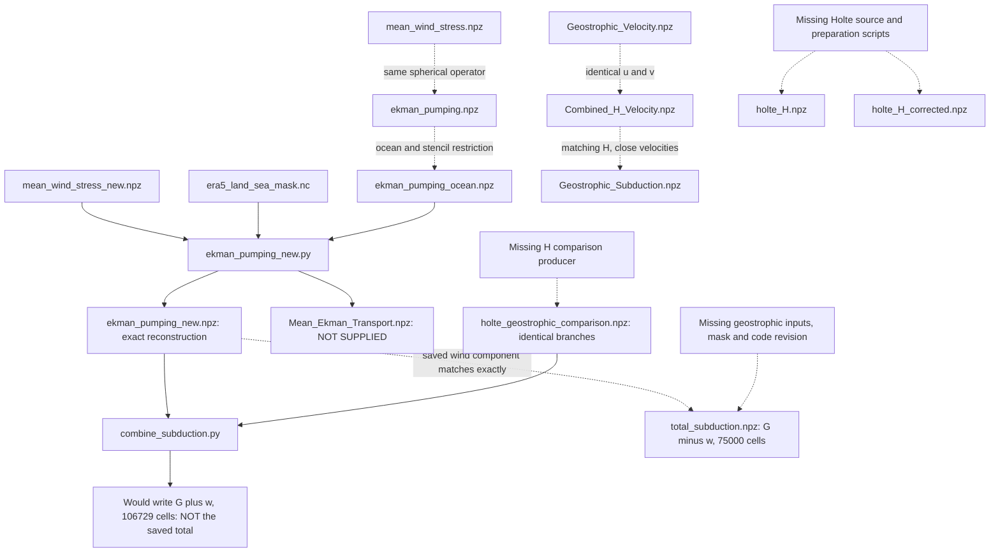

# Scientific audit of the partner circulation and subduction files

**Audit date:** 28 November 2026. **Scope:** investigation only. All 15 supplied
files in `data/temp/` were inspected: two Python scripts, twelve NPZ archives and
one NetCDF file, totalling **79,686,526 bytes**. Neither partner script was
executed or imported. Independent calculations used arrays in memory; no partner
file, production input, model equation, API, frontend or simulation was changed.

**Evidence labels:** **Verified** means directly read from a file or tested
numerically; **Inference** means supported interpretation without complete source
metadata; **Unresolved** means the supplied material cannot establish it.
Filename labels such as “new”, “corrected”, “Holte” and “geostrophic” are not
independent evidence of scientific correctness.

## 1. Executive summary

The folder contains a partly recoverable **static mean-circulation diagnostic**,
not a reproducible end-to-end circulation model. The useful ingredients are
horizontal velocity components, two wind-stress versions, an ERA5 land fraction,
and several H/subduction experiments. The largest problems are inconsistent
provenance between saved products and the scripts, not a lack of numerical data.

- **Verified:** `ekman_pumping_new.npz` is reproduced exactly by the supplied
  spherical Ekman calculation using `mean_wind_stress_new.npz` and the local mask.
  The old ocean product is reproduced to round-off by the **same operator** using
  the old stresses. “New” therefore does not establish an improved equation.
- **Verified:** the current `holte_geostrophic_comparison.npz` has **identical H
  and subduction arrays in its de Boyer and Holte branches**, including masks.
  Every finite saved difference is zero. It is not an independent H sensitivity.
- **Verified:** `total_subduction.npz` satisfies **Su = S_geo − w_Ek exactly** for
  both branches on 75,000 valid cells. The supplied combination script instead
  uses **S_geo + w_Ek**, would retain 106,729 cells with the matching Ekman input,
  and would yield identical branches from the current comparison archive.
  Consequently **the supplied script and current input files cannot reproduce
  the saved total**. Its wind component is identifiable, its geostrophic lineage
  and additional mask are not.
- **Verified:** the partner ERA5 land fractions are exactly our processed land
  fractions on the same 0.25° coordinates. However, the partner uses `lsm < 0.05`
  plus a five-point ocean stencil, whereas our classification is `lsm < 0.5`.
  These are different domains even though the underlying mask is the same.
- **Verified:** horizontal velocities cover only 66.5°S–77.5°N, on a 0.5° grid,
  with internal gaps and a problematic duplicated dateline. They cannot directly
  supply our entire extratropical domain. The Ekman field also leaves existing
  active cells unsupported near coasts and high latitudes.
- **Verified:** partner `Combined_H_Velocity.H` equals our current **bilinear**
  de Boyer H exactly at 104,535 common extratropical coordinate samples. This is
  strong numerical compatibility evidence, not proof of the missing preparation
  history. It is not evidence for replacing our H with Holte.

**Recommendation:** retain our H and active mask. Prioritise the standalone u/v
and new wind/Ekman branch for provenance recovery and offline validation. Do not
adopt the precomputed comparison or total subduction fields into the SST solver.

## 2. Complete inventory and dependencies

Roles below are interpretations of contents/names unless linked to explicit
code; relative chronological order is not established by upload timestamps.
Sizes are exact on-disk bytes. “Numerical link” below means matching contents,
not proof that the missing generating script read a particular filename. Every
NPZ array is listed with shapes, dtypes and statistics in section 14; section 6
summarises the principal physical fields.

| File | Bytes | Role/content | Dependencies/provenance |
|---|---:|---|---|
| [Combined_H_Velocity.npz](../data/temp/Combined_H_Velocity.npz) | 2,466,176 | Merged intermediate: H, u/v, lat/lon on G721. | Unknown writer; u/v equal velocity archive and H equals geostrophic-subduction H. Candidate input to missing geostrophic calculation; no supplied reader. |
| [Geostrophic_Subduction.npz](../data/temp/Geostrophic_Subduction.npz) | 3,347,183 | Legacy geostrophic diagnostic: H, u/v, S_geo, S_year on G721. | Unknown writer; H matches Combined, velocities are a slightly different revision. No supplied reader; not identical to the geostrophic terms in total. |
| [Geostrophic_Velocity.npz](../data/temp/Geostrophic_Velocity.npz) | 2,713,546 | Velocity input/intermediate: u, v, speed on G721. | Unknown original source/writer. u/v numerically reused in Combined; no supplied reader. |
| [combine_subduction.py](../data/temp/combine_subduction.py) | 3,496 | Combination/regridding/plotting executable script. | Reads CLI-selected Ekman archive and fixed holte_geostrophic_comparison.npz; writes total_subduction.npz and PNG. Current code does not reproduce saved total. |
| [ekman_pumping.npz](../data/temp/ekman_pumping.npz) | 13,166,828 | Old, unmasked pumping intermediate on E025. | Unknown writer; agrees with old ocean field on its support. Possible CLI input to combine, but does not match the saved total wind array. |
| [ekman_pumping_new.npz](../data/temp/ekman_pumping_new.npz) | 8,090,352 | Revised masked pumping output on E025. | Written by ekman_pumping_new.py, lines 84–90. Its aligned samples exactly equal the wind component in total_subduction.npz. |
| [ekman_pumping_new.py](../data/temp/ekman_pumping_new.py) | 2,788 | Spherical transport-divergence executable script. | Reads new stresses, mask and old ocean pumping; writes pumping plus an absent transport archive. See section 3. |
| [ekman_pumping_ocean.npz](../data/temp/ekman_pumping_ocean.npz) | 8,090,793 | Old ocean/stencil-masked pumping on E025. | Explicit comparison input to ekman_pumping_new.py, line 93. Unknown original writer; old-stress reconstruction verifies the operator. |
| [era5_land_sea_mask.nc](../data/temp/era5_land_sea_mask.nc) | 780,600 | ERA5 static land-fraction input; single timestamp. | Read by ekman_pumping_new.py, lines 52–60, but with a mismatched relative path. Exactly matches our processed land fractions. |
| [holte_H.npz](../data/temp/holte_H.npz) | 228,450 | Legacy H input/experiment on H1; incomplete month support. | Unknown writer/reader. Relationship to corrected file is unrecorded, not a verified transformation. |
| [holte_H_corrected.npz](../data/temp/holte_H_corrected.npz) | 877,260 | Alternative H input/comparison on H1; includes 12-month subsets. | Unknown writer/reader. A plausible upstream Holte candidate, but not traced to either saved subduction branch. |
| [holte_geostrophic_comparison.npz](../data/temp/holte_geostrophic_comparison.npz) | 3,347,852 | Purported H sensitivity output on G720; duplicated branches. | Explicit input to combine_subduction.py, lines 16 and 22–26. Generating script absent. |
| [mean_wind_stress.npz](../data/temp/mean_wind_stress.npz) | 16,630,132 | Old static stress input on E025. | Unknown averaging source. Reconstructs old raw/ocean Ekman products numerically; current script does not read this stress file. |
| [mean_wind_stress_new.npz](../data/temp/mean_wind_stress_new.npz) | 16,630,132 | Revised static stress input on E025. | Explicit input to ekman_pumping_new.py, lines 6–11. Distinct values despite same archive size. |
| [total_subduction.npz](../data/temp/total_subduction.npz) | 3,310,938 | Saved final diagnostic, with separate wind and two geostrophic/total branches on G720. | Named output of combine script, but actual contents require a different code/input revision. No supplied downstream reader. |

### Grid and metadata conventions

| Label | Stored axes and order | Shape of physical fields | Interpretation |
|---|---|---|---|
| **E025** | Latitude 90 → −90, step −0.25°; longitude 0 → 359.75, step +0.25° | 721 × 1440 | Full global ERA5 coordinates; support is smaller than the grid |
| **G721** | Latitude −66.5 → 77.5, step +0.5°; longitude −180 → +180, step +0.5° | 289 × 721 | Global longitude, restricted latitude; both dateline endpoints stored |
| **G720** | Same latitude; longitude −180 → 179.5, step +0.5° | 289 × 720 | Unique cyclic longitude samples, no duplicate endpoint |
| **H1** | Latitude −89.5 → 89.5, step +1°; longitude −179.5 → 179.5, step +1° | 180 × 360 | Global 1° cell centres, with sparse valid H |

All NPZ coordinate arrays are float64. Coordinate names vary (`lat/lon` versus
`latitude/longitude`). NPZ archives contain **no time axes, source identifiers,
unit attributes, averaging intervals or processing histories**. A static field
can be a climatological mean, but the name “mean” alone does not establish how
it was averaged. Spatial dimensions are verified; observation periods are
**unknown for every NPZ**, including both Holte products. All files have the
same upload-era filesystem timestamp, which is not an observation date.

**Units:** latitude/longitude degrees are inferred from coordinate values and
NetCDF agreement for E025; only the NetCDF explicitly declares degrees north/east.
Wind-stress units Pa = N m−2 and east/north directions are required by the code,
not stated in the stress archives. u/v/speed units m s−1 and east/north directions
are unconfirmed. H in metres is strongly supported for the shared de Boyer
samples by exact agreement with our validated metre-valued H; Holte units remain
inferred from context. Subduction keys ending `_m_per_s` explicitly label their
intended units; annual arrays match multiplication by 31,557,600 seconds exactly.
That verifies a conversion relationship, not the absolute units of the missing
upstream velocity/stress sources.

### NetCDF inspection

`era5_land_sea_mask.nc` dimensions are `valid_time=1`, `latitude=721`,
`longitude=1440`. Its variables are:

| Variable | Dimensions / dtype | Metadata and values |
|---|---|---|
| `lsm` | (valid_time, latitude, longitude), float32 | Units `(0 - 1)`; standard_name `land_binary_mask`; long_name `Land-sea mask`; GRIB parameter 172, regular latitude–longitude grid, surface, ECMWF analysis. Actual values are fractional, range 0–1, mean 0.3358972714; no missing/infinite values. |
| `latitude` | (latitude), float64 | `degrees_north`, standard_name `latitude`, stored_direction `decreasing`; 90 → −90 |
| `longitude` | (longitude), float64 | `degrees_east`, standard_name `longitude`; 0 → 359.75 |
| `valid_time` | (valid_time), raw int64; decoded datetime64[ns] | Raw 1577836800, units `seconds since 1970-01-01`, calendar `proleptic_gregorian`: **2020-01-01 00:00 UTC** |
| `number` | scalar int64 | 0; units `1`; standard_name `realization` |
| `expver` | scalar string | `0001`; no further attributes |

Global attributes identify ECMWF, `Conventions=CF-1.7`, centre `ecmf`, subcentre
0, and a GRIB-to-CF conversion on 2026-10-19 using cfgrib 0.9.15.1/ecCodes 2.48.2.
The history records a temporary GRIB filename, not a reproducible source request.
GRIB metadata gives 0.25° increments, Nx=1440, Ny=721 and missing-value sentinel
3.4028234663852886e38; no actual sentinel/missing values were found. The raw mask
snapshot date does **not** establish the averaging period of the wind stresses.
Full attributes, including the GRIB scanning flags, are retained in the ignored
[inventory JSON](../runs/partner_circulation_audit/inventory.json).

## 3. Walkthrough of every Python script

### 3.1 `ekman_pumping_new.py`: stress → transport → pumping

**Intended quantity:** vertical velocity associated with divergence of the
wind-driven, depth-integrated Ekman transport. “Transport” here is volume flow
per unit width, m²/s, not a horizontal velocity in m/s.

1. [Lines 6–11](../data/temp/ekman_pumping_new.py#L6) load the new static `tau_x`,
   `tau_y` arrays and their global E025 coordinates. There is no temporal
   preprocessing: any averaging occurred elsewhere and its script is absent.
2. [Lines 14–28](../data/temp/ekman_pumping_new.py#L14) hard-code spherical radius
   R=6.371×10⁶ m, rotation Ω=7.2921×10⁻⁵ s−1, rho=1025 kg/m³ and a 365.25-day
   conversion year. They convert degrees to radians and set f=2Ω sinφ to NaN
   outside 10° ≤ |latitude| ≤ 85°.
3. [Lines 31–49](../data/temp/ekman_pumping_new.py#L31) implement

   $$M_x=\frac{\tau_y}{\rho f},\qquad M_y=-\frac{\tau_x}{\rho f},$$

   $$w_{Ek}=\frac{\partial_\lambda M_x+
           \partial_\phi(M_y\cos\phi)}{R\cos\phi}.$$

   Longitude differentiation is centred, second-order, cyclic `np.roll` with
   spacing `lam[1]-lam[0]`. The provided 1440 unique, evenly spaced longitudes
   satisfy that assumption. Latitude differentiation is `np.gradient` using the
   actual radian coordinates; descending latitude is handled correctly. It is
   centred in the interior, with NumPy's default first-order end treatment.
   The cosφ metric factors and variation of f are included. This is **not** just
   curl(τ)/(rho f): keeping f inside the derivative includes the planetary
   variation term. Masking f before differentiation also contaminates adjacent
   rows: pumping is unavailable at exactly ±10° and ±85°, not merely outside
   the stated latitude interval.
4. [Lines 52–72](../data/temp/ekman_pumping_new.py#L52) read
   **`Data/era5_land_sea_mask.nc`**, squeeze its time dimension, assert matching
   coordinates, and require `lsm < 0.05` at the centre and four neighbours.
   Longitude mask neighbours wrap; latitude neighbours do not. This deliberately
   erodes coastal support by one grid cell to avoid differencing through land.
   Derivatives are formed first, but only ocean-only stencils survive. Valid
   rows actually span −78° to +84.75° after the ocean mask, with an equatorial gap.
5. [Lines 74–90](../data/temp/ekman_pumping_new.py#L74) save an intended
   `Mean_Ekman_Transport.npz` (Mx/My, intended units `m^2/s`) and
   `ekman_pumping_new.npz` (w and annualised w). **The transport file is absent**
   from the supplied folder. Its transport mask would be centre-ocean only,
   broader than the pumping stencil mask; those masks must not be confused.
6. [Lines 93–116](../data/temp/ekman_pumping_new.py#L93) compare against old ocean
   pumping on shared finite cells. The reconstructed statistics are RMS old
   49.506735, RMS new 52.989042, RMS difference **5.700947 m/year**, or **11.5155%**
   of old RMS. These are unweighted cell statistics, not area-weighted fluxes.

**Reproducibility:** all numerical input arrays are present and the independent
calculation reproduces the saved new pumping **bit-for-bit**. The script is not
runnable as-is from this flat folder because its `Data/` mask path does not exist;
from the repository root its other bare relative inputs are also missing.
The audit supplied paths only to its own read-only reconstruction, without fixing
or executing the partner file. There is no main guard: importing the file would
run calculation and writes. It saves outputs before the old-product checks, so
later failure could leave overwritten products. This is why it was not run.

### 3.2 `combine_subduction.py`: aligned pumping + two labelled geostrophic terms

**Intended quantity:** total subduction for two choices of H. It computes no
horizontal velocities, H gradients or geostrophic divergence itself.

1. [Lines 8–26](../data/temp/combine_subduction.py#L8) accept a mandatory
   `--ekman` path, but hard-code `holte_geostrophic_comparison.npz` relative to
   the current working directory. They read its `S_deboyer_m_per_s`,
   `S_holte_m_per_s` and later `common_valid`; no stress/H source is checked.
2. [Lines 30–43](../data/temp/combine_subduction.py#L30) reverse descending ERA5
   latitude along with the field. They extend the unique 0–359.75° longitude
   grid with cyclic ghost columns and wrap target longitude modulo 360.
3. [Lines 47–78](../data/temp/combine_subduction.py#L47) use linear
   `RegularGridInterpolator` on values and a finite-data coverage array.
   Missing values are temporarily represented by zero **for interpolation
   bookkeeping**, not accepted as physical zero. Results require interpolated
   coverage ≥0.999, then divide by coverage. Thus the method rejects substantially
   partial source support; it does not fill arbitrary coastal gaps. A tiny
   invalid-corner weight below 0.001 can still be tolerated, so it is not a
   mathematically exact all-four-corners test. Out-of-range targets stay NaN.

   For these actual grids, every G720 target centre is an exact E025 centre:
   0.5° points are a subset of 0.25° points. The operation reduces to sampling
   aligned source nodes, rather than creating new spatial detail or performing
   area-conservative aggregation. The periodic extension is appropriate for
   the supplied unique ERA5 longitude axis.
4. [Lines 81–89](../data/temp/combine_subduction.py#L81) intersect the common
   geostrophic mask with finite wind and both finite S arrays. They then execute

   ```python
   Su_d = np.where(valid, S_d + w_regridded, np.nan)
   Su_h = np.where(valid, S_h + w_regridded, np.nan)
   ```

   **This plus sign differs from the specified target's minus wind term.** It
   also differs from the saved total's exact algebra; see sections 5 and 8.
5. [Lines 92–101](../data/temp/combine_subduction.py#L92) overwrite the fixed
   total filename. Geostrophic and total arrays are masked by `valid`, but
   `w_Ek_m_per_s` is deliberately saved over its wider interpolation support.
   Hence its all-finite-cell mean is not the mean wind contribution used by Su.
6. [Lines 104–140](../data/temp/combine_subduction.py#L104) print finite common-mask
   means/RMS/medians using a 365.25-day year, then plot the de Boyer total with
   symmetric 98th-percentile colour clipping. They save `total_subduction.png`
   (absent from the supplied folder), then call interactive `plt.show()`.
   Clipping changes the picture, not stored values.

**Reproducibility:** it can find all named array inputs if called from
`data/temp/` with the appropriate CLI path, but it would overwrite the supplied
NPZ and **cannot reproduce its current contents**. New Ekman input reproduces
its saved wind array exactly, but the visible script produces a different mask,
wind sign and geostrophic branches. An older/different producer or input version
is missing. No scientific result should be attributed to this source revision
without that clarification.

## 4. Reconstructed dependency diagram

Solid arrows represent explicit reads/writes with numerical verification where
stated. Dashed arrows are numerical relationships or missing/unverified lineage,
not assertions about absent generating code.



The local corrected Holte arrays cannot be connected to the saved distinct Holte
subduction branch by verified code. The current comparison archive cannot explain
that branch because its two H/S arrays are identical. `Geostrophic_Subduction`
also fails to reproduce the total's de Boyer term (common-cell RMS difference
1.07725e−5 m/s on 73,510 cells; 1,490 total cells lack that legacy S altogether).

## 5. Physical equations, units and signs

Let λ be longitude, φ latitude, R radius, and H a **positive depth in metres**.
Use eastward/northward horizontal velocities and upward-positive vertical w.
The supervisor's specified stationary diagnostic is

$$S_u=-w_{Ek}-\nabla_h\cdot(H\mathbf v_g).$$

Positive Su then denotes downward export under those conventions; a negative
value denotes upward exchange/obduction rather than “negative ocean depth”.
For a spatially varying H, the geostrophic term must be

$$G=-\frac{1}{R\cos\phi}
 \left[\partial_\lambda(Hu_g)+\partial_\phi(Hv_g\cos\phi)\right]
 =-\mathbf v_g\cdot\nabla_hH-H\nabla_h\cdot\mathbf v_g.$$

The first expanded term is **lateral induction**: horizontal flow crosses a
sloping mixed-layer base. The second accounts for horizontal convergence or
divergence of the velocity itself. Three-dimensional incompressibility does
not make this horizontal divergence zero. Dropping it without justification
changes the specified diagnostic. Published subduction formulations also use
velocity at the mixed-layer base; a surface geostrophic map is not automatically
a depth-mean or base velocity. See the [fixed-boundary/kinematic discussion](https://www.whoi.edu/fileserver.do?id=100164&p=119089&pt=2)
and [a published subduction definition](https://os.copernicus.org/articles/20/817/2024/).
These references give context, not provenance for these NPZ files.

For standard wind stress **on the ocean**, the script's transport signs imply
`w_Ek = div(M_Ek)`, upward-positive at the Ekman-layer base. Integrating continuity
with negligible surface vertical velocity gives this sign directly. It is the
radial curl of τ/(rho f), including variable f. The [Harvard teaching notes](https://web-static-aws.seas.harvard.edu/climate/eli/Courses/EPS231/2017spring/climate_dynamics_teaching_notes.pdf)
likewise state the upward-positive convention. Thus positive pumping must be
subtracted for downward-positive Su. If the NPZ stresses instead use the opposite
stress convention, the physical interpretation changes; their missing source
metadata must resolve that, not a filename assumption.

The original script's plus sign is therefore inconsistent with the requested
formula **under the standard stress convention**. The saved total's minus sign
is algebraically consistent with the requested wind term, but the unidentified
G arrays prevent certifying the full physical calculation.

There is one explicit wind contribution in the visible combination and in the
saved identity. No factor-of-two wind contribution was found. Upstream G
producers are absent, so hidden inclusion of wind-driven transport cannot be
excluded. In future, adding M_Ek/H to a velocity labelled geostrophic and then
also subtracting w_Ek would count its transport divergence twice. Keep the two
transport definitions separate and documented.

H arrays are spatially varying and have no time axis. Our fixed late-winter
framework does not require a seasonal dH/dt term. It does require establishing
that the partner's chosen H really is an appropriate maximum-monthly winter
climatology, which these archives alone cannot prove. Likewise, a static local
Eulerian flux diagnostic is not automatically a Lagrangian estimate of permanent
annual water-mass ventilation. Multiplication by seconds/year changes units;
it does not establish an annual averaging period.

## 6. Array metadata and numerical statistics

All statistics below use **finite values only**, without zero replacement.
Minima/maxima are not clipped. P1/P50/P99 are unweighted cell percentiles; means
are not area-weighted and must not be interpreted as global net volume fluxes.
All supplied numeric arrays contain **zero infinities**. The all-array appendix
in section 14 lists every coordinate, mask and field, including NaN fractions.

### Important physical fields in approachable units

Velocity units below are assumed m/s; annualised quantities use the key-declared
m/s × 31,557,600 s/year. Those qualifications are part of the interpretation.

| File / field | Units used here | Finite / grid cells | NaN % | Min | P1 | Median | Mean | P99 | Max |
|---|---|---:|---:|---:|---:|---:|---:|---:|---:|
| `Geostrophic_Velocity` / `speed` | assumed m/s | 118,521/208,369 | 43.12 | 6.66083e-05 | 0.00443082 | 0.0408296 | 0.0615376 | 0.281576 | 1.83453 |
| `Combined_H_Velocity` / `H` | m, supported by current-H match | 154,052/208,369 | 26.07 | 10.2567 | 17.1684 | 84.7507 | 106.105 | 418.696 | 1221.18 |
| `holte_H` / `H_da` | assumed m | 11,060/64,800 | 82.93 | 95.0001 | 95.1895 | 103.141 | 102.927 | 109.884 | 109.997 |
| `holte_H_corrected` / `H_da` | assumed m | 34,887/64,800 | 46.16 | 7.91675 | 14.2512 | 91.9942 | 109.152 | 397.141 | 1055.23 |
| `holte_H_corrected` / `H_dt` | assumed m | 34,887/64,800 | 46.16 | 7.91675 | 14.8427 | 97.1257 | 121.756 | 483.254 | 1529.78 |
| `ekman_pumping` / `w_Ek` | m/year, intended | 861,120/1,038,240 | 17.06 | -12038.4 | -828.697 | -8.19609 | -4.11764 | 807.449 | 13756.9 |
| `ekman_pumping_ocean` / `w_Ek` | m/year, intended | 528,377/1,038,240 | 49.11 | -1904.69 | -88.3757 | -8.20368 | -2.83822 | 132.171 | 1630 |
| `ekman_pumping_new` / `w_Ek` | m/year, intended | 528,377/1,038,240 | 49.11 | -2097.38 | -94.1914 | -8.76894 | -3.04302 | 138.136 | 1790.61 |
| `Geostrophic_Subduction` / `S_geo` | m/year, inferred | 115,705/208,369 | 44.47 | -28334.7 | -1120.95 | -0.741022 | -6.35014 | 1044.74 | 20472.2 |
| `holte_geostrophic_comparison` / `S_deboyer_m_per_s` | m/year, key-declared | 129,235/208,080 | 37.89 | -64764.3 | -1552.74 | -0.253098 | 4.11219 | 1568.88 | 157704 |
| `total_subduction` / `Su_deboyer_m_per_s` | m/year, key-declared | 75,000/208,080 | 63.96 | -21145.7 | -1647.18 | 25.6229 | 5.81967 | 1535.62 | 18603.1 |
| `total_subduction` / `Su_holte_m_per_s` | m/year, key-declared | 75,000/208,080 | 63.96 | -32237.2 | -3458.23 | 24.7004 | 2.37059 | 3309.84 | 43057 |

The velocity magnitude is internally correct: `speed` equals hypot(u,v) wherever
both components exist, maximum error 1.11e−16 in stored units. The global maximum
u=4.5463 is at 3°N, 50.5°W **where v and speed are missing**, so its exceeding the
maximum saved speed is not a vector-arithmetic error. The complete-vector speed
maximum 1.83453 is at 3°N, 50°W. Both are outside our domain. Within |lat| ≥20°,
speed has median 0.03628, P99 0.25029 and maximum 0.75688 (25.5°N, 79.5°W), in
assumed m/s. These are interpretable as background/current-jet magnitudes, but
neither the averaging period nor surface/base/absolute/anomaly meaning is known.

The full raw old pumping also reproduces exactly from the old stresses before
ocean masking. The raw Ekman archive includes **294,939 finite points classified as land** by
our lsm<0.5 rule. Its large all-point RMS/extremes are not an ocean-only diagnostic.
Both ocean pumping archives have zero finite land points at either threshold.
The new product's strongest global features are near 11.75°S, 48.75°E and
15.5°N, 264.75°E. Many lie outside the model's ±20° limits. Nevertheless, eight
extratropical points exceed 1000 m/year; its extratropical range is −1194.57 to
+1273.64 m/year. Coastal wind-stress gradients can produce large derivatives;
source averaging and stencil sensitivity must be checked before calling these
physical climatological vertical velocities.

The comparison archive's maximum 157,704 m/year is at 1.5°N, 49.5°W, also outside
our domain. Its extratropical range still reaches approximately −30,107 to
+29,287 m/year. The total's extreme de Boyer values occur around 56°N, 57.5°W
and 76°N, 5°W; its Holte-labelled maximum is 43,057 m/year near 56°N, 57°W.
These large tails warrant investigation of gradients, coast/seam handling and
source versions, not automatic clipping. Counts above 10,000 m/year are 51 in
the legacy geostrophic product, 131 in the duplicated comparison, 29 in the
saved de Boyer total and 159 in the Holte total. Thresholds are **audit flags**,
not a universal physical rejection criterion or corrections to the data.

## 7. Grid, H and mask compatibility with the SST model

| Property | Current production model | Partner files | Consequence |
|---|---|---|---|
| Grid | Native ERA5 0.25°, descending latitude, 0–359.75° longitude | Wind/mask match exactly; velocities/geostrophic products are 0.5°, latitude ascending, mostly −180–180° | Velocity use would require coordinate normalisation, duplicate-seam resolution and validated remapping onto the existing grid |
| Domain | Northern ≥20° and southern ≤−20°, including supported high latitudes | Geostrophic band only −66.5–77.5°; wind excludes equator and near poles | No silent extrapolation, zero filling or shrinking of active cells |
| Ocean | lsm<0.5, plus validated H/forcing/initialisation support | Ekman lsm<0.05 and neighbour erosion; geostrophic masks differ | Same underlying ERA5 mask does not mean same usable domain |
| H | Fixed, spatially varying ERA5-targeted bilinear de Boyer Montégut (2023) maximum-monthly H; limited baseline polar retention | Combined/de Boyer-labelled H on 0.5° grid; separate uncertain Holte alternatives on 1° grid | Keep current H; precomputed partner G cannot automatically be transferred |
| Time | Historical forcing and January 1979 observed initialisation, fixed background H | Static arrays, unknown averaging windows | Suitable only as candidate stationary backgrounds, not verified transient forcing |
| Numerics | Existing backward-Euler surface-flux/conservative-diffusion solver | Offline point-derivative diagnostics | Existing implicit diffusion does not establish safe/conservative advection |

The current input boundary explicitly enforces the ERA5 classification and
selected H without expanding the domain; see [runtime.py](../src/ssta_model/data/runtime.py#L17),
[H selection](../src/ssta_model/data/runtime.py#L90),
[primary configuration](../configs/historical_surface_flux_bilinear_h.toml),
and [architecture](architecture.md). Saved primary-model masks contain
232,211 active northern and 274,670 southern cells, **506,881 combined**.

### Same mask values, different filtering

All 1,038,240 partner land fractions are exactly equal to our processed
`land_fraction`, with identical coordinates. lsm<0.5 identifies **686,392** global
node locations; lsm<0.05 identifies **661,443** before any stencil/latitude filter:
24,949 fewer. New pumping is finite at 528,377 nodes globally. On our actual
active mask it supplies 178,712 northern and 267,861 southern cells, leaving
**53,499 north and 6,809 south unsupported**. Unsupported area fractions are
10.824% north and 2.000% south. These cells must remain an explicit scientific
coverage decision; this audit did not fill or deactivate them.

Velocity latitude limits alone exclude **65,058 northern and 28,307 southern
active cells**, respectively 5.650% and 5.157% of each hemisphere's active ocean
area. Internal velocity gaps reduce support further. A nearest-centre availability
probe gives only 116,696 north and 219,825 south with both components; this is
**not** a validated interpolation coverage estimate and may overstate usable
four-corner support. No native model field was regridded or changed.

### H identity and land coverage

At exact shared extratropical coordinates, Combined H matches our current
bilinear H with **zero numerical difference** on 42,492 northern and 62,043
southern samples. Against our original containing-cell H, RMS differences are
15.537 m north and 10.544 m south, with maxima 365.505 and 119.237 m. This
supports the bilinear de Boyer interpretation. Counts are stored-coordinate
samples, including the duplicated dateline endpoint, not additional unique
ocean area. Masks are not identical: thousands
of partner H samples lie outside the corresponding current H support, and
Combined has 5,927 finite centres classified as ERA5 land on its full G721 grid.
The comparison H branches have 9,389 such centres each. No direct production
H substitution is justified by the common-value identity.

Raw velocity pairs have no jointly valid ERA5-land centres on G721, although v
alone has one; saved legacy geostrophic S has one and comparison S has eleven.
The saved total has no finite land centres under the sampled ERA5 classification.
Coarse/coastal mask differences need an explicit common-mask policy, not an
assumption that every NaN is land or every finite value is ocean.

Corrected Holte H has 269 finite centres classified as ERA5 land for each general
H array, versus ten for each 12-month-complete subset. These comparisons sample
ERA5 at existing 1° centres; coastline resolution differences can explain some
mismatches, so they are compatibility flags rather than proof of invalid Argo
profiles.

## 8. Scientific consistency checks and confirmed discrepancies

### 8.1 The saved total uses subtraction, not the script's addition

On all 75,000 saved valid cells, for **both** branches:

| Check | Maximum residual | RMS residual | Finding |
|---|---:|---:|---|
| Su − (S_geo − w_Ek) | 0 | 0 | Exact stored identity |
| Su − (S_geo + w_Ek) | 8.071844e−5 m/s | 2.758958e−6 m/s | Does not match visible script |

The latter RMS is **87.0661 m/year**; it is exactly the consequence of the two
opposite wind signs when using the saved components. Common-mask annual means:

| Branch | Mean G | Mean w_Ek | Mean saved Su = G−w |
|---|---:|---:|---:|
| de Boyer label | −8.680637 | −14.500303 | +5.819666 |
| Holte label | −12.129710 | −14.500303 | +2.370593 |

Units are intended m/year. The stored wind is finite at 117,879 G720 locations,
including 42,879 outside `valid`; component means above correctly use only the
shared total mask. Mixing all-finite wind means with total-mask geostrophic
means would create a misleading consistency calculation.

### 8.2 The current inputs cannot generate that total

- New pumping, periodically sampled exactly as the script specifies, reproduces
  saved `w_Ek_m_per_s` **bit-for-bit**, including its NaNs. Old/raw pumping does not.
- With that wind and the supplied comparison archive, the current code would
  accept **106,729 cells**, 31,729 more than the saved total, and yield two
  identical branches. Saved totals instead differ between branches.
- On the 75,000 shared cells, saved de Boyer G differs from the comparison G by
  RMS **1.17077e−5 m/s**, maximum **7.55040e−4 m/s**. The Holte G RMS difference
  is **3.91407e−5 m/s**, maximum **1.89755e−3 m/s**. This is not simply a wind-sign
  change or a display conversion.
- Comparing to `Geostrophic_Subduction.S_geo` also fails, as noted in section 4.

**Confirmed conclusion:** code/input/output revision mismatch. It is not possible
to infer which missing revision is scientifically authoritative from file names.

### 8.3 The Holte sensitivity is duplicated, and its preparation remains unknown

`H_deboyer == H_holte` at all 157,277 finite locations, with identical NaN masks.
`S_deboyer == S_holte` at all 129,235 finite locations, and the difference array
is zero wherever finite. An independent Holte sensitivity cannot be assessed
from this file. The comparison H matches Combined H on all 153,770 shared
nonduplicated-longitude points, but adds 3,507 finite cells of unknown provenance.

The standalone old Holte archive has only 11,060 finite H_da and 13,859 finite
H_dt values. Its maxima are roughly 110/116 in assumed metres, and its valid-month
counts never exceed 6/7. The corrected archive has 34,887 finite H_da/H_dt cells
and counts up to 12. Its complete subsets contain exactly **18,611** cells;
their masks equal `valid_months == 12` and their values equal the corresponding
general H on those cells. Both versions consistently have H missing when the
named valid-month count is zero.

These are real internal improvements in recorded coverage/completeness, not
proof of a correct preparation method. On shared cells the old/corrected H_da
correlation is only 0.0913 (RMS difference 82.924 m); H_dt correlation is 0.0716
(RMS 103.775 m). The difference is not a trivial file rename. The narrow old H
range and limited months are suspicious, but the exact cause—selection, missing
values, units or variable choice—cannot be diagnosed without the producer.

The [Holte provider](https://mixedlayer.ucsd.edu/) distinguishes density algorithm
and density-threshold products and several monthly statistics. Interpreting
`da`/`dt` that way is reasonable, **not verified NPZ metadata**. The raw monthly
file and transformation are absent, so max(monthly mean), max(monthly maximum),
partial-year selection and depth/pressure conversion cannot be distinguished.
The provider's published Argo periods/version descriptions must not be assigned
to these unversioned archives. Holte remains comparison-only.

The standalone velocity has no complete vectors at |latitude|<3°; legacy
S_geo is unavailable within 3.5°. The comparison S nevertheless has finite
values at the equator. Its producer therefore cannot be assumed to differentiate
only the unfilled supplied velocity pair. Different velocity inputs or filling
are plausible explanations, not verified corrections. Our ≥20° domains avoid
this equatorial region, but the lineage inconsistency remains relevant.

### 8.4 Geostrophic differentiation: promising interior evidence, unresolved edges

No geostrophic generating script is supplied. Independently differentiating the
Combined H/u/v with the **negative spherical flux divergence** from section 5,
using R=6.371e6 and `np.gradient` on the coordinates, agrees closely with legacy
S_geo in the interior: 114,960 common non-edge cells have RMS residual
1.35104e−11 m/s, maximum 4.51508e−10 m/s (about 0.01425 m/year maximum).
This strongly supports that functional form, including the spherical metric
factor, rather than a claim that all geostrophic calculations are nonspherical.
It does **not** identify the exact missing source code or all stencils.

Full-array RMS residual is 6.01526e−8 m/s; maximum 4.97748e−6 m/s occurs at the
±180° boundary near 55°S (about 157 m/year). The common finite masks also differ:
202 saved S cells have no finite reconstruction. Other tested forms—Cartesian
flux divergence and lateral induction alone—fit worse. No guessed calculation
was substituted for a saved field.

The velocity archive has duplicate −180°/+180° columns, but v differs by as much
as **0.0568313** in assumed m/s, with two asymmetric missing endpoints. u/H
endpoints agree. Legacy geostrophic-subduction v endpoints agree with one
another and approximately with the mean of the two original endpoints (within
2.87e−7), suggesting seam reconciliation in an absent producer. Its v mask
also differs (183 newly finite versus two lost cells), and u differs slightly
beyond a simple float64→float32 cast. Therefore the files are not merely dtype
copies. `np.roll` directly on a duplicated 721-column grid is not a correct
unique cyclic stencil; naive removal of one endpoint also discards the other
nonmatching v value. The seam policy needs the generating script, not a silent
choice during integration. G720 first/last columns, in contrast, are distinct
neighbouring longitudes and are **not** expected to have equal values.

## 9. Risks and limitations

| Status | Risk | Why it matters / next check |
|---|---|---|
| Confirmed | Script/data sign and revision mismatch | Recover the exact producer and input hashes before interpreting saved totals |
| Confirmed | Identical Holte/de Boyer comparison branches | Recover a genuine H comparison; zero saved difference is not evidence of negligible H sensitivity |
| Confirmed | Incomplete velocity/pumping support | Our full active domain cannot be retained by directly inserting these fields |
| Confirmed | Dateline discrepancies and version-specific masks | Establish a unique periodic vector grid before differentiation/remapping |
| Confirmed | Sparse/incomplete Holte support | A maximum over missing seasonal months can miss winter depth; missing preparation prevents verification |
| Unresolved | Absolute units, directions, averaging periods, source versions | Needed to distinguish a mean current from an anomaly, and stress on ocean from its opposite |
| Unresolved | Geostrophic velocity depth interpretation | Surface velocity cannot automatically represent the whole fixed winter mixed layer or its base |
| Concern, not proven error | Very large local geostrophic/subduction tails | Differentiate sensitivity to H gradients, sea/coast mask and unresolved interpolation; do not automatically clip |
| Concern | Means on unequal masks or unweighted lat/lon cells | Can produce misleading component budgets/global interpretations |
| Future numerical risk | Monthly advection stability/conservation | Existing implicit diffusion is not an advection discretisation |

An illustrative 30-day Courant number on our 0.25° spacing,
`dt*(|u|/dx + |v|/dy)` with spherical dx and dy, has median **5.17**, P95 **25.33**,
P99 **40.60**, maximum **104.94** on complete extratropical partner vectors,
**assuming m/s units**. This is a diagnostic calculation, not a proposed timestep
or a model run. It warns against simply adding explicit monthly advection:
stability, monotonicity and conservation need deliberate numerical treatment.
The diffusion solver's backward-Euler stability does not solve that problem.

Correct temporal preprocessing matters as much as differentiation. The
[official ERA5 documentation](https://confluence.ecmwf.int/pages/viewpage.action?pageId=235634513)
distinguishes accumulated eastward turbulent stress `ewss` (N m−2 s) from mean
stress `metss` (N m−2). Their conversion needs the product's accumulation/averaging
semantics; it is not certified by plausible magnitudes. Ocean-only stresses here
are much smaller than global maxima: revised tau_x ranges −0.379 to +0.282,
tau_y −0.294 to +0.420 in assumed Pa. Global ±1–3 values occur outside this
strict ocean subset, so those maxima alone do not prove an ocean-unit error.

With fixed H, fixed masks and a linear differential operator, averaging stress
or velocity before this diagnostic can commute with the operator. Nevertheless,
one must know the averaging window/weights and distinguish mean stress from
stress calculated from mean wind, a nonlinear operation. The archives do not
establish whether the means are annual, seasonal, late-winter or single-event
means, or whether their periods are mutually consistent. Masked, truncated
latitude coverage also prevents treating the reported unweighted mean pumping
as a full-sphere conservation test.

## 10. Compatibility and missing external information

The velocity NPZ **does contain both horizontal components** needed to form an
advection operator; speed alone would not suffice. u/v are independent of H in
the saved standalone archive and exactly match Combined u/v, so they can be
investigated without adopting partner H. This does not establish their original
source or whether they are absolute velocities versus anomalies. For example,
[official altimetry documentation](https://confluence.ecmwf.int/spaces/CKB/pages/514766994/Sea%2BLevel%2Bversion%2BDT2024%2BProduct%2BUser%2BGuide%2Band%2BSpecification)
distinguishes absolute geostrophic velocities (`ugos/vgos`) from anomalies
(`ugosa/vgosa`). **There is no evidence identifying these NPZ files as that product.**
Mean advection requires the correct mean-flow interpretation.

Ekman pumping is mathematically independent of H in the supplied script; it can
likewise be validated separately. Its coordinates already match our grid, so no
spatial interpolation is needed for overlapping native cells. Its stricter
coastal/polar mask still leaves production holes. Velocity would need future
mask-aware periodic vector remapping from 0.5° to 0.25°, preserving east/north
components and explicitly handling unsupported regions, not inventing fine-scale
currents. Partner H gradients/subduction cannot simply be interpolated as a
substitute for calculating the specified transport divergence with our H.

| Needed information/source | Is it currently supplied? | Why needed |
|---|---|---|
| Original velocity product, units, reference level, mean/anomaly definition, averaging interval and generating code | No; u/v arrays only | Establish physical interpretation and reproduce seam/mask handling |
| Velocity support for missing high-latitude/other active cells, or an explicitly justified boundary/coverage treatment | No | Preserve the existing global extratropical domain; many altimetry products also lack ice/polar coverage, so a replacement must be evaluated rather than assumed global |
| Original ERA5 stress variable IDs, request dates/product type and mean/conversion code | No | Verify stress units/sign, temporal mean and old/new distinction; documented provenance may suffice without a new bulk download |
| Exact geostrophic/H comparison and saved-total producer revisions | No | Explain two distinct final branches, 75,000-cell mask and opposite wind sign |
| Original monthly Holte NetCDF/MAT and selection metadata | No | Necessary only to validate the optional Holte comparison, not to replace current H |
| Definition/evidence that surface u/v approximate depth-mean or base velocity at our H | No | Justify the transport used by the fixed mixed-layer framework |
| Current de Boyer H, ERA5 mask, forcing and initialisation | Yes, outside this folder | Already sufficient for the baseline; no new MLD input is required |

No additional dataset was downloaded for this investigation. Public documentation
was consulted for definitions only. No temperature tendency follows from a
subduction rate alone: thermal exchange would additionally require an agreed
vertical temperature contrast/closure. That is a later scientific decision,
not something to infer or add to the present solver from these arrays.

## 11. Reuse recommendations

“A” below means sufficiently clear for the stated limited use, not automatic
permission to put a new term in production.

| Category | Item | Reason and next validation step |
|---|---|---|
| **A — reusable now** | Partner ERA5 mask as a reference/check | Exact coordinates/land fractions equal current inputs. Continue using our existing processed mask and lsm<0.5; no replacement needed. |
| **A — reusable now** | Spherical Ekman transport/divergence equations and periodic ERA5 longitude pattern as a reference calculation | Dimensional/metric structure is clear and saved new values reproduce exactly. Use as an offline validation reference; do not run the overwrite-style script in production. |
| **B — after validation/modification** | `Geostrophic_Velocity.npz` u/v | Actual vector components with internally correct speed and potentially useful extratropical magnitudes. Recover provenance/units/depth meaning, resolve dateline and missing coverage, then validate remapping on our fixed domain. |
| **B** | `mean_wind_stress_new.npz` and `ekman_pumping_new.npz` | Strongest identifiable pipeline, independent of H and already on ERA5 coordinates. Establish source period/stress semantics, audit extremes and choose an explicit coastal/polar coverage policy. |
| **B** | `mean_wind_stress.npz` and `ekman_pumping_ocean.npz` | Reproducible older reference using the same operator. Determine why stresses changed; do not label inferior merely because old. |
| **B** | `Combined_H_Velocity.npz` | Useful cross-check of velocity identity and current bilinear H at common points. Lacks authoritative preparation and contains H over current land. Keep our H rather than adopt this mapped copy. |
| **B — comparison only** | `holte_H_corrected.npz` | Better recorded completeness, internally consistent 12-month subsets. Need raw monthly source, units and exact winter/max selection before interpreting sensitivity. Never substitute for current H automatically. |
| **B as method evidence; C for direct field adoption** | `Geostrophic_Subduction.npz` | Interior agrees very closely with negative spherical flux divergence, but source revisions, dateline/masks and extremes remain unresolved. Recompute a diagnostic with validated u/v and current H later; do not transfer precomputed values directly. |
| **C — not direct adoption** | `holte_geostrophic_comparison.npz` | H and S branches are identical; cannot support a Holte-versus-de Boyer conclusion. Obtain the genuine comparison producer/input revision. |
| **C** | `total_subduction.npz` and current `combine_subduction.py` as a reproducible pair | Exact saved subtraction is useful evidence, but current code adds and uses incompatible upstream fields/mask. Resolve lineage and signs before any scientific use as a forcing/diagnostic. |
| **C** | `holte_H.npz` for late-winter H adoption | Sparse months, narrow range and weak agreement with corrected file; origin unknown. Retain as historical evidence, not an authoritative MLD map. |
| **C** | Unmasked `ekman_pumping.npz` as ocean pumping | Hundreds of thousands of finite land values; retain only as a raw intermediate for provenance comparisons. |

## 12. Questions for the partner

1. Which original product/version produced u/v? Are components east/north in m/s,
   surface or depth-dependent, absolute or anomaly, instantaneous or climatological?
   What dates and weights define the mean? Was special equatorial handling used?
2. Please provide the velocity, Combined H, geostrophic-divergence and Holte
   preparation scripts, raw variable names and source download/request metadata.
3. Why do the two dateline v endpoints differ? Which revision reconciled the
   endpoints and changed v masks/precision in `Geostrophic_Subduction`?
4. Which H was used in each saved G? Our bilinear H agrees exactly at common
   samples, while the comparison's Holte and de Boyer H/S are duplicated.
   Was that comparison file overwritten after generating the total?
5. What distinguishes old/new mean stresses: dates, variables, sampling,
   accumulation conversion, quality control, seasonal weighting or sign?
6. Is τ the stress on the ocean? Is w positive upward? Was the final combination
   changed from plus to minus after the supplied script revision?
7. What generated the distinct saved G arrays and the 75,000-cell total mask,
   rather than the current script's 106,729 cells? Please provide that code and
   hashes of its actual inputs.
8. What do `da`/`dt` denote exactly, and which statistic/monthly variable was
   reduced to H? Were incomplete years/months accepted? Were depths originally
   metres or pressure? What changed in the “corrected” preparation?
9. Where is `Mean_Ekman_Transport.npz`, and are any wind-driven components already
   incorporated in the supplied quantities labelled geostrophic?
10. What treatment was intended for unsupported coasts, high latitudes and
    artificial tropical domain boundaries? What interpretation was intended for
    the very large local subduction tails?

## 13. Suggested next implementation milestone — not performed

First obtain a versioned, unit/sign-labelled source bundle that resolves the
questions above. Then build a **standalone offline subduction diagnostic**, with
no SST integration, using validated velocity/stress inputs, our unchanged H and
our explicit domain. Its output should identify unsupported cells rather than
silently filling them or changing the active mask.

Validate against controlled zero-stress/zero-velocity cases, a cyclic analytic
spherical field, constant-H/nondivergent flow, a known H slope, and a variable-f
Ekman case. Compare flux-form divergence with its expanded terms, test seam and
coast stencils, and record source hashes, units, signs and masks. Decide whether
the velocities represent the mixed-layer transport and how domain boundaries
are handled before planning a conservative advection scheme. Only after that
milestone should a separate proposal consider changes to the SST solver.

## 14. Complete array statistics appendix

The following tables retain **raw saved numerical units**, so m/s and m/year
arrays are not mixed. F64/F32 = float64/float32, I64 = int64, B = bool. Axis
arrays have no NaNs; their means/percentiles describe coordinates, not physics.
For boolean masks, the mean is the true fraction, and “finite” does not mean
true/valid. For valid-month counts, zero is a count, not a zero mixed-layer depth.
See section 2 for intended/inferred physical units and coordinate conventions.

### Combined_H_Velocity.npz

| Array | Shape | Type | Finite / total | NaN % | Min | P1 | Median | Mean | P99 | Max |
|---|---|---|---:|---:|---:|---:|---:|---:|---:|---:|
| `H` | 289 × 721 | F64 | 154,052/208,369 | 26.068 | 10.25666 | 17.16842 | 84.75073 | 106.1045 | 418.696 | 1221.185 |
| `u` | 289 × 721 | F64 | 119,775/208,369 | 42.518 | -0.7226693 | -0.1991105 | 0.01864662 | 0.02017865 | 0.221783 | 4.546303 |
| `v` | 289 × 721 | F64 | 120,773/208,369 | 42.039 | -0.8545347 | -0.1359239 | 0.001177375 | 0.0009227608 | 0.1273533 | 1.11871 |
| `lat` | 289 | F64 | 289/289 | 0.000 | -66.5 | -65.06 | 5.5 | 5.5 | 76.06 | 77.5 |
| `lon` | 721 | F64 | 721/721 | 0.000 | -180 | -176.4 | 0 | 0 | 176.4 | 180 |

### Geostrophic_Subduction.npz

| Array | Shape | Type | Finite / total | NaN % | Min | P1 | Median | Mean | P99 | Max |
|---|---|---|---:|---:|---:|---:|---:|---:|---:|---:|
| `lon` | 721 | F64 | 721/721 | 0.000 | -180 | -176.4 | 0 | 0 | 176.4 | 180 |
| `lat` | 289 | F64 | 289/289 | 0.000 | -66.5 | -65.06 | 5.5 | 5.5 | 76.06 | 77.5 |
| `H` | 289 × 721 | F64 | 154,052/208,369 | 26.068 | 10.25666 | 17.16842 | 84.75073 | 106.1045 | 418.696 | 1221.185 |
| `u` | 289 × 721 | F32 | 119,775/208,369 | 42.518 | -0.7226693 | -0.1991105 | 0.01864662 | 0.02017865 | 0.2217831 | 4.546303 |
| `v` | 289 × 721 | F32 | 120,954/208,369 | 41.952 | -0.8545349 | -0.1363264 | 0.001180896 | 0.000926436 | 0.1282309 | 1.11871 |
| `S_geo` | 289 × 721 | F64 | 115,705/208,369 | 44.471 | -0.000897873 | -3.552073e-05 | -2.348156e-08 | -2.012236e-07 | 3.310587e-05 | 0.0006487245 |
| `S_year` | 289 × 721 | F64 | 115,705/208,369 | 44.471 | -28334.72 | -1120.949 | -0.7410217 | -6.350135 | 1044.742 | 20472.19 |

### Geostrophic_Velocity.npz

| Array | Shape | Type | Finite / total | NaN % | Min | P1 | Median | Mean | P99 | Max |
|---|---|---|---:|---:|---:|---:|---:|---:|---:|---:|
| `lon` | 721 | F64 | 721/721 | 0.000 | -180 | -176.4 | 0 | 0 | 176.4 | 180 |
| `lat` | 289 | F64 | 289/289 | 0.000 | -66.5 | -65.06 | 5.5 | 5.5 | 76.06 | 77.5 |
| `u` | 289 × 721 | F64 | 119,775/208,369 | 42.518 | -0.7226693 | -0.1991105 | 0.01864662 | 0.02017865 | 0.221783 | 4.546303 |
| `v` | 289 × 721 | F64 | 120,773/208,369 | 42.039 | -0.8545347 | -0.1359239 | 0.001177375 | 0.0009227608 | 0.1273533 | 1.11871 |
| `speed` | 289 × 721 | F64 | 118,521/208,369 | 43.120 | 6.660831e-05 | 0.004430821 | 0.04082965 | 0.06153761 | 0.2815759 | 1.834527 |

### ekman_pumping.npz

| Array | Shape | Type | Finite / total | NaN % | Min | P1 | Median | Mean | P99 | Max |
|---|---|---|---:|---:|---:|---:|---:|---:|---:|---:|
| `latitude` | 721 | F64 | 721/721 | 0.000 | -90 | -88.2 | 0 | 0 | 88.2 | 90 |
| `longitude` | 1440 | F64 | 1,440/1,440 | 0.000 | 0 | 3.5975 | 179.875 | 179.875 | 356.1525 | 359.75 |
| `w_Ek` | 721 × 1440 | F64 | 861,120/1,038,240 | 17.060 | -0.0003814745 | -2.625983e-05 | -2.597185e-07 | -1.304801e-07 | 2.558651e-05 | 0.0004359296 |
| `w_Ek_m_per_year` | 721 × 1440 | F64 | 861,120/1,038,240 | 17.060 | -12038.42 | -828.6971 | -8.196091 | -4.117639 | 807.4488 | 13756.89 |

### ekman_pumping_new.npz

| Array | Shape | Type | Finite / total | NaN % | Min | P1 | Median | Mean | P99 | Max |
|---|---|---|---:|---:|---:|---:|---:|---:|---:|---:|
| `latitude` | 721 | F64 | 721/721 | 0.000 | -90 | -88.2 | 0 | 0 | 88.2 | 90 |
| `longitude` | 1440 | F64 | 1,440/1,440 | 0.000 | 0 | 3.5975 | 179.875 | 179.875 | 356.1525 | 359.75 |
| `w_Ek` | 721 × 1440 | F64 | 528,377/1,038,240 | 49.108 | -6.646187e-05 | -2.984745e-06 | -2.77871e-07 | -9.64274e-08 | 4.377266e-06 | 5.674099e-05 |
| `w_Ek_m_per_year` | 721 × 1440 | F64 | 528,377/1,038,240 | 49.108 | -2097.377 | -94.1914 | -8.768942 | -3.043017 | 138.136 | 1790.609 |

### ekman_pumping_ocean.npz

| Array | Shape | Type | Finite / total | NaN % | Min | P1 | Median | Mean | P99 | Max |
|---|---|---|---:|---:|---:|---:|---:|---:|---:|---:|
| `latitude` | 721 | F64 | 721/721 | 0.000 | -90 | -88.2 | 0 | 0 | 88.2 | 90 |
| `longitude` | 1440 | F64 | 1,440/1,440 | 0.000 | 0 | 3.5975 | 179.875 | 179.875 | 356.1525 | 359.75 |
| `w_Ek` | 721 × 1440 | F64 | 528,377/1,038,240 | 49.108 | -6.035606e-05 | -2.800456e-06 | -2.599589e-07 | -8.993774e-08 | 4.188251e-06 | 5.165154e-05 |
| `w_Ek_m_per_year` | 721 × 1440 | F64 | 528,377/1,038,240 | 49.108 | -1904.692 | -88.37566 | -8.20368 | -2.838219 | 132.1712 | 1629.998 |

### holte_H.npz

| Array | Shape | Type | Finite / total | NaN % | Min | P1 | Median | Mean | P99 | Max |
|---|---|---|---:|---:|---:|---:|---:|---:|---:|---:|
| `latitude` | 180 | F64 | 180/180 | 0.000 | -89.5 | -87.71 | 0 | 0 | 87.71 | 89.5 |
| `longitude` | 360 | F64 | 360/360 | 0.000 | -179.5 | -175.91 | 0 | 0 | 175.91 | 179.5 |
| `H_da` | 180 × 360 | F64 | 11,060/64,800 | 82.932 | 95.00012 | 95.18953 | 103.1413 | 102.9272 | 109.8835 | 109.9968 |
| `H_dt` | 180 × 360 | F64 | 13,859/64,800 | 78.613 | 95.00161 | 95.23017 | 106.5776 | 106.2319 | 115.8201 | 115.998 |
| `valid_months_da` | 180 × 360 | I64 | 64,800/64,800 | 0.000 | 0 | 0 | 0 | 0.2392593 | 3 | 6 |
| `valid_months_dt` | 180 × 360 | I64 | 64,800/64,800 | 0.000 | 0 | 0 | 0 | 0.3374228 | 3 | 7 |

### holte_H_corrected.npz

| Array | Shape | Type | Finite / total | NaN % | Min | P1 | Median | Mean | P99 | Max |
|---|---|---|---:|---:|---:|---:|---:|---:|---:|---:|
| `latitude` | 180 | F64 | 180/180 | 0.000 | -89.5 | -87.71 | 0 | 0 | 87.71 | 89.5 |
| `longitude` | 360 | F64 | 360/360 | 0.000 | -179.5 | -175.91 | 0 | 0 | 175.91 | 179.5 |
| `H_da` | 180 × 360 | F64 | 34,887/64,800 | 46.162 | 7.91675 | 14.25125 | 91.99416 | 109.1522 | 397.1407 | 1055.228 |
| `H_dt` | 180 × 360 | F64 | 34,887/64,800 | 46.162 | 7.91675 | 14.84272 | 97.12566 | 121.7561 | 483.2537 | 1529.782 |
| `H_da_complete` | 180 × 360 | F64 | 18,611/64,800 | 71.279 | 13.02641 | 29.12522 | 95.48496 | 118.432 | 426.4176 | 1055.228 |
| `H_dt_complete` | 180 × 360 | F64 | 18,611/64,800 | 71.279 | 13.02641 | 29.76626 | 102.5362 | 135.2688 | 522.2211 | 1529.782 |
| `valid_months_da` | 180 × 360 | I64 | 64,800/64,800 | 0.000 | 0 | 0 | 4 | 5.531667 | 12 | 12 |
| `valid_months_dt` | 180 × 360 | I64 | 64,800/64,800 | 0.000 | 0 | 0 | 4 | 5.531667 | 12 | 12 |

### holte_geostrophic_comparison.npz

| Array | Shape | Type | Finite / total | NaN % | Min | P1 | Median | Mean | P99 | Max |
|---|---|---|---:|---:|---:|---:|---:|---:|---:|---:|
| `latitude` | 289 | F64 | 289/289 | 0.000 | -66.5 | -65.06 | 5.5 | 5.5 | 76.06 | 77.5 |
| `longitude` | 720 | F64 | 720/720 | 0.000 | -180 | -176.405 | -0.25 | -0.25 | 175.905 | 179.5 |
| `H_deboyer` | 289 × 720 | F64 | 157,277/208,080 | 24.415 | 10.25666 | 16.56164 | 83.19513 | 104.8883 | 417.4558 | 1221.185 |
| `H_holte` | 289 × 720 | F64 | 157,277/208,080 | 24.415 | 10.25666 | 16.56164 | 83.19513 | 104.8883 | 417.4558 | 1221.185 |
| `S_deboyer_m_per_s` | 289 × 720 | F64 | 129,235/208,080 | 37.892 | -0.002052256 | -4.920348e-05 | -8.020207e-09 | 1.303075e-07 | 4.97148e-05 | 0.004997333 |
| `S_holte_m_per_s` | 289 × 720 | F64 | 129,235/208,080 | 37.892 | -0.002052256 | -4.920348e-05 | -8.020207e-09 | 1.303075e-07 | 4.97148e-05 | 0.004997333 |
| `difference_m_per_year` | 289 × 720 | F64 | 129,235/208,080 | 37.892 | 0 | 0 | 0 | 0 | 0 | 0 |
| `common_valid` | 289 × 720 | B | 208,080/208,080 | 0.000 | 0 | 0 | 1 | 0.6210832 | 1 | 1 |

### mean_wind_stress.npz

| Array | Shape | Type | Finite / total | NaN % | Min | P1 | Median | Mean | P99 | Max |
|---|---|---|---:|---:|---:|---:|---:|---:|---:|---:|
| `latitude` | 721 | F64 | 721/721 | 0.000 | -90 | -88.2 | 0 | 0 | 88.2 | 90 |
| `longitude` | 1440 | F64 | 1,440/1,440 | 0.000 | 0 | 3.5975 | 179.875 | 179.875 | 356.1525 | 359.75 |
| `tau_x` | 721 × 1440 | F64 | 1,038,240/1,038,240 | 0.000 | -1.664265 | -0.2101676 | 0.003479744 | 0.01451781 | 0.2460532 | 2.739125 |
| `tau_y` | 721 × 1440 | F64 | 1,038,240/1,038,240 | 0.000 | -1.465002 | -0.1237755 | -9.523332e-05 | 0.004477313 | 0.1921774 | 1.681405 |

### mean_wind_stress_new.npz

| Array | Shape | Type | Finite / total | NaN % | Min | P1 | Median | Mean | P99 | Max |
|---|---|---|---:|---:|---:|---:|---:|---:|---:|---:|
| `latitude` | 721 | F64 | 721/721 | 0.000 | -90 | -88.2 | 0 | 0 | 88.2 | 90 |
| `longitude` | 1440 | F64 | 1,440/1,440 | 0.000 | 0 | 3.5975 | 179.875 | 179.875 | 356.1525 | 359.75 |
| `tau_x` | 721 × 1440 | F64 | 1,038,240/1,038,240 | 0.000 | -1.605711 | -0.2117172 | 0.003348743 | 0.01519177 | 0.2547034 | 2.738445 |
| `tau_y` | 721 × 1440 | F64 | 1,038,240/1,038,240 | 0.000 | -1.540098 | -0.1257973 | 0.0001646678 | 0.00457292 | 0.1939107 | 1.762323 |

### total_subduction.npz

| Array | Shape | Type | Finite / total | NaN % | Min | P1 | Median | Mean | P99 | Max |
|---|---|---|---:|---:|---:|---:|---:|---:|---:|---:|
| `latitude` | 289 | F64 | 289/289 | 0.000 | -66.5 | -65.06 | 5.5 | 5.5 | 76.06 | 77.5 |
| `longitude` | 720 | F64 | 720/720 | 0.000 | -180 | -176.405 | -0.25 | -0.25 | 175.905 | 179.5 |
| `valid` | 289 × 720 | B | 208,080/208,080 | 0.000 | 0 | 0 | 0 | 0.3604383 | 1 | 1 |
| `w_Ek_m_per_s` | 289 × 720 | F64 | 117,879/208,080 | 43.349 | -4.826248e-05 | -2.966368e-06 | -4.419521e-07 | -1.907686e-07 | 4.228312e-06 | 5.674099e-05 |
| `S_geo_deboyer_m_per_s` | 289 × 720 | F64 | 75,000/208,080 | 63.956 | -0.000668918 | -5.152997e-05 | -5.853361e-09 | -2.750728e-07 | 4.925761e-05 | 0.0005910815 |
| `S_geo_holte_m_per_s` | 289 × 720 | F64 | 75,000/208,080 | 63.956 | -0.001020145 | -0.0001091542 | -1.107103e-08 | -3.843673e-07 | 0.0001047779 | 0.001365327 |
| `Su_deboyer_m_per_s` | 289 × 720 | F64 | 75,000/208,080 | 63.956 | -0.0006700681 | -5.219607e-05 | 8.11941e-07 | 1.844141e-07 | 4.866099e-05 | 0.0005894969 |
| `Su_holte_m_per_s` | 289 × 720 | F64 | 75,000/208,080 | 63.956 | -0.001021536 | -0.0001095849 | 7.827074e-07 | 7.511956e-08 | 0.0001048825 | 0.001364393 |

## 15. Audit reproducibility and non-destructive checks

Generated diagnostics are under ignored `runs/partner_circulation_audit/`:

- `inventory.json`: exact sizes, SHA-256 values, numeric metadata, all finite-only
  percentiles (P0.1, P1, P5, P25, P50, P75, P95, P99, P99.9), coordinate vectors
  and full NetCDF variable/global attributes.
- `consistency.json`, `grid_checks.json`, `final_checks.json`,
  `extratropical_checks.json` and `additional_identities.json`: numerical
  reconstructions, masks, coverage, candidate derivatives and residuals.
- Standalone inspection/diagnostic scripts: independent array calculations,
  never imports or execution of the supplied scripts. NPZ reads used
  `allow_pickle=False`; no object-pickle loading was needed.
- [Physical-field diagnostic](../runs/partner_circulation_audit/physical_fields.png)
  and [support masks](../runs/partner_circulation_audit/support_masks.png).
  Pumping/geostrophic/total labels distinguish intended or assumed units;
  geostrophic/total panels share colour limits. Clipped colours do not change
  data. Missing values remain missing.

All 15 supplied files passed checks against their initial SHA-256, byte size
and modification time after diagnostics. Audit checks require exact new-Ekman
reconstruction, exact annualisation, exact saved subtraction identities, expected
mask counts and detected duplicated comparison branches. These are checks of
observed contents, not a scientific endorsement. No numerical solver, frontend
or API tests were needed for this report-only change, and no simulation was run.
Only this Markdown report is intended for the Git commit; source data, generated
figures and numerical audit products remain ignored.
